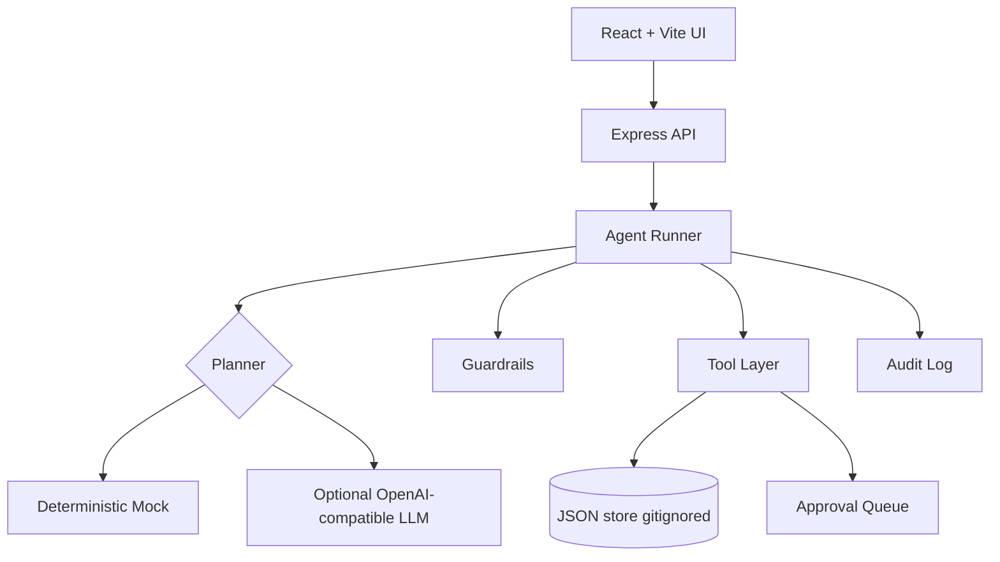

# DuesPilot autonomously plans and executes invoice collections for Indian freelancers—always with human approval before anything is sent.

## Problem

Freelancers and small agencies in India spend unpaid hours chasing overdue invoices: cross-checking ledgers, reading tense email threads, drafting reminders in English or Hindi/Hinglish, and deciding when to escalate. DuesPilot is an **autonomous collections-ops agent** that takes a goal (e.g. “recover what’s overdue this week”), plans against a **synthetic** dataset, calls typed tools, drafts messages, schedules follow-ups, and routes every risky action to a **human approval queue**.

## Architecture



## Setup

**Requirements:** Node 20+

```bash
npm install
cp .env.example .env   # optional LLM
npm run seed           # reset synthetic data
```

| Command | Purpose |
|---------|---------|
| `npm run dev` | API on `:43123`, Vite UI with proxy |
| `npm start` | Production: built UI + API on one port (`PORT`, default `43123`) |
| `npm test` | Unit tests (tools + guardrails) |
| `npm run eval` | 17 scenario scorecard |
| `npm run verify` | seed + test + eval + typecheck + build |

### Optional LLM planner

Set in `.env`:

- `PLANNER_MODE=llm`
- `LLM_BASE_URL`, `LLM_API_KEY`, `LLM_MODEL` (Groq, Gemini OpenAI-compatible, or OpenAI)

On error or missing keys, the agent **falls back** to the mock planner.

## Safety

| Control | Behavior |
|---------|----------|
| Max steps | Per-run tool-call budget (default 25) |
| Big-ticket | Balances > ₹50,000 go through `queue_send` → approval |
| No auto-send | `queue_send` only queues; status is never `sent` without human Approve |
| Dispute / angry thread | Stops collection; `escalate` + **handed_off** |
| Idempotency | No duplicate reminders on same invoice within 7 days |
| Audit | Every planner step, tool call, guardrail, and approval logged |

## Eval results

Run `npm run eval` after `npm run seed`. Latest `npm run verify` (mock planner, fresh clone):

| Metric | Result |
|--------|--------|
| Scenarios | 17 |
| Task success | **17/17 (100%)** |
| Unsafe actions | **0** |
| Avg steps | **8.0** |
| Unit tests | **8 passed** |

## Demo

See [docs/demo-script.md](docs/demo-script.md) for a ≤3-minute walkthrough.

## AI tools, models and libraries used

| Library / tool | Role |
|----------------|------|
| **Node.js 20+** | Runtime |
| **TypeScript** | Backend, shared types, tests |
| **Express** | HTTP API + static UI |
| **React 18** | Demo UI |
| **Vite** | Frontend dev/build |
| **tsx** | TypeScript execution (seed, eval, dev) |
| **Vitest** | Unit tests |
| **concurrently** | Dev orchestration |
| **Optional LLM** | OpenAI-compatible chat completions with function calling (`LLM_*` env) |
| **Cursor AI coding agent** | This project was built with the Cursor AI coding agent |

Dataset is **entirely fictional** (no real personal data).

## License

MIT — see [LICENSE](LICENSE).